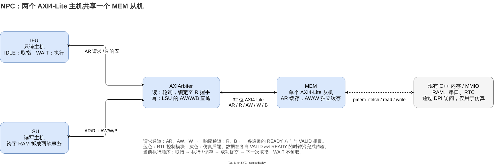

# NPC AXI4-Lite 总线改造设计报告

整理日期：2026-10-12。本文依据本次对话、当前工作区代码和已保存的验证记录编写。本次整理新增文档与结构图，不追加 RTL 功能修改。

## 1. 本次对话与设计决策

本次工作将 NPC 的取指、访存和内存接口从 simple bus 迁移到 32 位 AXI4-Lite，采用两个主机经仲裁器访问一个 MEM 从机的结构。执行顺序仍为取指、执行或访存、成功提交、再次取指。

| 阶段 | 明确的要求或决策 | 实施结果 |
| --- | --- | --- |
| 总体规划 | IFU 只读，LSU 读写，共享一个 MEM；保留完整 AXI4 的扩展边界 | 采用 IFU/LSU → AXIArbiter → MEM 的连接 |
| MEM 改造 | 当阶段只修改 MEM；AR 握手锁存；AW/W 独立缓存；R/B 保持至握手 | MEM 改为五通道 AXI4-Lite 从机，读写各有状态机 |
| 综合范围澄清 | 仅要求 AXI 控制逻辑可综合，内存继续通过现有 DPI 访问 | 仿真后端集中在 MEM；未增加外部存储器后端端口 |
| 提示词优化 | 明确角色、文件范围、行为约定、状态机表、验证与交付标准 | 后续 IFU 任务按此结构执行，先给状态表，再直接实现 |
| IFU 改造 | 当阶段只修改 IFU；IDLE 完成取指读事务；WAIT 执行当前指令 | IFU 成为只读 AXI4-Lite 主机，WAIT 禁止发起 AR |
| LSU 与整机接入 | 后续授权改造 LSU、实现仲裁器并接入 top | 完成 LSU、AXIArbiter、top、构建参数和 C++ 错误/提交路径调整 |

规划中确定的其他行为包括：RAM 跨字访问用两笔独立事务兼容；跨字 MMIO 预先拒绝；总线错误记录后终止仿真；当前只加入 AXI4-Lite 信号，完整 AXI4 的位置通过模块边界和注释说明。

“先只修改 MEM”“先只修改 IFU”是对应阶段的范围限制。最终集成阶段根据后续指令扩展到了 LSU、仲裁器、top 和必要的仿真及构建代码。

## 2. 总体结构与职责



图源：[axi4-lite-architecture.drawio](axi4-lite-architecture.drawio)，可在 draw.io 中继续编辑。

| 模块 | 责任 | 当前容量 |
| --- | --- | --- |
| IFU | 锁存 PC，发起取指读请求，保存指令，等待执行完成 | 最多一笔未完成取指 |
| LSU | 锁存 CPU 访存请求，生成字地址和字节选通，拆分/拼接跨字访问 | 同时处理一条 CPU 访存请求；可顺序生成两笔 AXI 事务 |
| AXIArbiter | 选择读主机，保持响应归属；转发 LSU 写通道 | 共享读端最多一笔未完成读；只有 LSU 写入 |
| MEM | 缓存总线请求，检查地址/设备规则，访问 DPI，保持响应 | 一笔未完成读和一笔未完成写；读写方向独立 |
| top/WBU | 连接模块，控制指令完成与提交，更新体系结构状态 | 多周期、按指令顺序执行 |
| C++ 仿真层 | 提供 RAM/MMIO 后端、读取调试状态、在提交前检查错误 | 保留现有内存 API |

当前 IFU 在 WAIT 状态不预取，因此整机正常执行时，取指与该指令的 LSU 读请求不会同时发起。仲裁器仍支持两个读主机并发请求，并通过模块级测试验证，为后续流水化或预取保留连接边界。

## 3. 接口与握手约定

本工程选用 32 位地址、32 位数据的 AXI4-Lite。协议采用单拍事务，读传输宽度等于总线宽度；字节和半字写入通过 WSTRB 表达。当前接口没有 ID、LEN、SIZE、BURST、LAST，未加入独占访问。AXI4-Lite 本身允许多个未完成事务；本实现主动限制接收数量。[协议依据：Arm IHI 0022H，B1.1](https://developer.arm.com/-/media/Arm%20Developer%20Community/PDF/IHI0022H_amba_axi_protocol_spec.pdf#page=120)。

| 通道 | 载荷 | 方向，以主机为参照 |
| --- | --- | --- |
| AR | ARADDR[31:0]、ARPROT[2:0] | 主机发出读地址 |
| R | RDATA[31:0]、RRESP[1:0] | 主机接收读响应 |
| AW | AWADDR[31:0]、AWPROT[2:0] | 主机发出写地址 |
| W | WDATA[31:0]、WSTRB[3:0] | 主机发出写数据 |
| B | BRESP[1:0] | 主机接收写响应 |

每个通道都有独立的 VALID/READY。定义 `*_fire = *_VALID && *_READY`，请求接收、数据消费和相关寄存器更新发生在 fire 为真的时钟上升沿。发送端的 VALID 和载荷在反压期间持续保持，到握手后才允许撤销或切换。[握手依据：Arm IHI 0022H，A3.2](https://developer.arm.com/-/media/Arm%20Developer%20Community/PDF/IHI0022H_amba_axi_protocol_spec.pdf#page=41)。

实现遵守以下约定：

1. IFU/LSU 发出 VALID 时不等待对应 READY。
2. AW 与 W 可以不同周期到达，各自独立完成握手。
3. MEM 在 AR 握手时保存地址和属性；在 AW/W 各自握手时保存各自载荷。
4. MEM 仅在两份写载荷齐备后执行写访问并生成 B 响应。
5. MEM 的 R/B 载荷先写入寄存器，再进入响应状态；等待 READY 不重复访问后端。
6. 所有模块共享 `clk` 和低有效 `rst_n`。复位撤销 VALID、清除事务和错误状态；复位不回滚已经执行的内存写入。

IFU 的 `ARPROT=3'b101`，表示取指、secure、privileged；LSU 的 ARPROT/AWPROT 为 `3'b001`，表示数据、secure、privileged。MEM 用 ARPROT[2] 选择取指或数据 DPI 路径，当前未实施安全性和权限检查。

## 4. MEM 从机设计

### 4.1 读状态机

| 当前状态 | 输出/寄存器动作 | 转移条件 | 下一状态 |
| --- | --- | --- | --- |
| RD_IDLE | 缓冲区空闲且延迟结束时 ARREADY=1；AR 握手锁存 ARADDR/ARPROT | ar_fire | RD_ACCESS |
| RD_ACCESS | 检查地址和访问类型；合法时访问 DPI 一次；锁存 RDATA/RRESP，错误数据为 0 | 无条件 | RD_DELAY |
| RD_DELAY | 读结果保持，RVALID=0，等待响应延迟 | r_delay_done | RD_RESP |
| RD_RESP | RVALID=1；RDATA/RRESP 保持；不接收下一笔 AR | r_fire | RD_IDLE |

未满足转移条件时保持当前状态；复位进入 RD_IDLE。

读请求在 AR 握手后与上游实时信号解耦。即使主机随后改变地址、改变属性，或延迟 RREADY，当前响应仍使用已锁存的请求。RTC 等可能产生访问副作用的读操作也仅在 RD_ACCESS 执行一次。

### 4.2 写状态机与独立缓存

| 当前状态 | 输出/寄存器动作 | 转移条件 | 下一状态 |
| --- | --- | --- | --- |
| WR_COLLECT | AW/W 缓存分别空闲且对应延迟结束时允许 READY；分别锁存地址/属性和数据/选通 | `(aw_pending || aw_fire) && (w_pending || w_fire)` | WR_ACCESS |
| WR_ACCESS | 使用缓存检查写请求；合法时执行一次写访问阶段；锁存 BRESP | 无条件 | WR_DELAY |
| WR_DELAY | 保持 BRESP，BVALID=0，等待响应延迟 | b_delay_done | WR_RESP |
| WR_RESP | BVALID=1，BRESP 保持；不再接收 AW/W | b_fire；清除两个 pending | WR_COLLECT |

AW 缓存包含 `awaddr_r/awprot_r/aw_pending`，W 缓存包含 `wdata_r/wstrb_r/w_pending`。如果 AW 先到，AWREADY 在该份载荷接收后关闭，W 通道仍可等待并接收；W 先到时行为对称。两者同周期到达也能正确处理。

齐备判断包含本周期的 fire，但实际写操作在后续 WR_ACCESS 中执行。这样执行阶段读到的是已经更新的两份寄存器，不会混用旧地址或旧数据。

### 4.3 地址解码和响应

默认 RAM 为 `0x80000000` 至 `0x87ffffff`，共 128 MiB。MEM 将总线地址按 4 字节向下对齐，检查完整 32 位字是否处于 RAM。当前 serial 与 RTC 的解码窗口各为 8 字节。

| 区域/请求 | 取指读 | 数据读 | 非零 WSTRB 写 |
| --- | --- | --- | --- |
| RAM 中完整 32 位字 | OKAY；pmem_ifetch | OKAY；pmem_read，长度 4 | OKAY；按 WSTRB 更新字节 |
| SERIAL_MMIO 与 +4 所在字 | DECERR | SLVERR | 仅 SERIAL_MMIO 且 WSTRB=0001 为 OKAY，其余 SLVERR |
| RTC_MMIO 与 +4 所在字 | DECERR | OKAY；长度 4 | SLVERR |
| 其他地址/关闭的设备 | DECERR | DECERR | DECERR |

`WSTRB=0000` 是独立特例：当前 MEM 对任何地址返回 OKAY，且不调用写后端。此规则在地址解码前应用。

错误先由 RTL 检查后返回，不进入对应 DPI 访问，避免非法 MMIO 触发主机端断言或设备副作用。当前 RRESP/BRESP 来源于 RTL 的 RAM/MMIO 规则；现有 DPI API 没有通用的后端错误返回值。

### 4.4 WSTRB 到原有 DPI API 的转换

后端继续使用 `pmem_write(addr, data, len)`，不修改为带字节选通的 C++ 接口。

| WSTRB | DPI 写法 |
| --- | --- |
| 0000 | 不写 |
| 1111 | 原字地址，长度 4 |
| 0011 | 原字地址，长度 2 |
| 0110 | 地址 +1，数据右移 8，长度 2 |
| 1100 | 地址 +2，数据右移 16，长度 2 |
| 其他掩码 | 固定四字节循环，仅对选中 lane 发起长度 1 的写入 |

“执行一次写操作”指每笔 AXI 写请求只进入一次写访问阶段，每个选中字节只写入一次。稀疏掩码可能在该阶段产生多个 DPI 调用。BREADY 反压或随机响应延迟不会重复执行这些调用。

### 4.5 可综合范围

MEM 的握手、缓存、状态机、地址检查和响应寄存器采用可综合语法。DPI import、适配 task 和调用通过 `ifndef SYNTHESIS` 隔离。

**定义 SYNTHESIS 后，MEM 没有实际存储器后端：读数据保持为 0，写入不产生存储效果。综合检查只证明控制部分能够综合，不能据此宣称具备可运行的 FPGA/ASIC 存储器。** 本次未增加 BRAM、SRAM 或外部存储器端口，符合澄清后的范围。

## 5. IFU 只读主机设计

IFU 的主状态为 IDLE/WAIT，IDLE 内部用 FETCH_DELAY、FETCH_AR、FETCH_R、FETCH_FAULT 区分总线阶段。状态寄存器、下一状态组合逻辑和载荷寄存器更新分开组织。

| 当前状态 | 输出/寄存器动作 | 转移条件 | 下一状态 |
| --- | --- | --- | --- |
| IDLE/FETCH_DELAY | 不发出 AR；延迟结束的时钟沿锁存 PC 到 ARADDR | fetch_delay_done | IDLE/FETCH_AR |
| IDLE/FETCH_AR | ARVALID=1，锁存的 ARADDR 保持 | ar_fire | IDLE/FETCH_R |
| IDLE/FETCH_R | RREADY=1；只在 R 握手时采样数据/响应 | r_fire 且 RRESP=OKAY；保存 inst | WAIT |
| IDLE/FETCH_R | 锁存错误响应；inst 置 NOP，不进入执行状态 | r_fire 且 RRESP 非 OKAY | IDLE/FETCH_FAULT |
| IDLE/FETCH_FAULT | 错误保持；ARVALID/RREADY=0 | 复位 | IDLE/FETCH_DELAY |
| WAIT | ifu_valid=1，inst 保持；ARVALID/RREADY=0 | `!mem_valid || memfinish` | IDLE/FETCH_DELAY |

无转移条件满足时保持。复位将 inst 初始化为 `32'h00000013`，清除地址和错误。

非访存指令在一个 WAIT 周期完成；访存指令一直保持 WAIT，直到 top 的成功提交信号反馈给 memfinish。当前执行中的指令不会被新的 RDATA 覆盖。

IFU 不需要写状态机。主机驱动的 AWADDR、AWPROT、AWVALID、WDATA、WSTRB、WVALID 和 BREADY 全部为 0。AWREADY/WREADY/BVALID/BRESP 是从机驱动的输入，top 将其接常量 0；IFU 不产生写请求，也不接收写响应。

IFU 本身没有 DPI 调用。取指 DPI 访问发生在 MEM：IFU 提交带取指属性的 AR，MEM 返回 R。

## 6. LSU 读写主机设计

### 6.1 状态机与 CPU 请求生命周期

LSU 保留 CPU 侧已有的地址、数据、宽度、符号扩展和完成握手接口，在总线侧生成 AXI4-Lite。CPU 侧宽度编码为：1=byte，2=halfword，3=word，0 为非法。

| 当前状态 | 输出/寄存器动作 | 转移条件 | 下一状态 |
| --- | --- | --- | --- |
| IDLE | 锁存地址、读写类型、宽度、符号位、原始写数据；初始化 beat 标记和握手标记 | mem_valid | CHECK |
| CHECK | 检查宽度与跨字地址跨度；预检查错误锁存原始地址/响应 | 合法 / 非法 | DELAY / FAULT |
| DELAY | 等待本笔请求的发起延迟；不发出 VALID | delay_done；按读写选择 | RD_ADDR / WR_SEND |
| RD_ADDR | ARVALID=1，字对齐地址保持 | ar_fire | RD_DATA |
| RD_DATA | RREADY=1；成功时保存首字或提取最终结果 | r_fire，响应错误 / 还需第二笔 / 已完成 | FAULT / DELAY / DONE |
| WR_SEND | AWVALID 与 WVALID 由各自 sent 标记控制；各自握手分别置位 | 两通道均已接受，包括本周期 fire | WR_RESP |
| WR_RESP | BREADY=1；成功且需第二笔时更新地址和 beat 标记 | b_fire，响应错误 / 还需第二笔 / 已完成 | FAULT / DELAY / DONE |
| DONE | lsu_done=1，最终读结果保持；不发起新事务 | lsu_finish | IDLE |
| FAULT | 错误保持；请求 VALID 与响应 READY 均关闭 | 复位 | IDLE |

CPU 输入仅在 IDLE 接收请求时使用，后续处理依赖请求寄存器。DONE 在 lsu_finish 之前保持，即使 mem_valid 仍为高也不会重复发起请求。top 在同一提交沿结束 IFU WAIT 并确认 LSU DONE，下一周期不会重复执行原指令。

每笔写事务维护独立的 `aw_sent/w_sent`。AW 先握手时只撤销 AWVALID；WVALID 和 W 载荷继续保持，反向顺序同理。第二笔跨字事务重新清零两个标记。

### 6.2 字节选通与跨字判定

设 CPU 地址为 A，访问字节数为 n：

```text
offset      = A[1:0]
word_addr   = A & ~3
split       = offset + n > 4
write_pack  = zero_extend_64(raw_data) << (8 * offset)
strobe_pack = ((1 << n) - 1) << offset
```

write_pack 的低/高 32 位分别作为第一/第二笔 WDATA；strobe_pack 的低/高 4 位分别作为对应 WSTRB。内部的 64 位数据和 8 位选通只是两笔事务的准备寄存器，外部仍是 32 位数据、4 位 WSTRB 的接口。

| CPU 访问 | offset | AXI 事务数量 |
| --- | --- | --- |
| byte | 0、1、2、3 | 1 |
| halfword | 0、1、2 | 1 |
| halfword | 3 | 2 |
| word | 0 | 1 |
| word | 1、2、3 | 2 |

举例：向 `0x80000003` 写入 word `0xAABBCCDD`。

| 事务 | AWADDR | WDATA | WSTRB | 写入的字节 |
| --- | --- | --- | --- | --- |
| 第一笔 | 0x80000000 | 0xDD000000 | 1000 | 0x80000003=DD |
| 第二笔 | 0x80000004 | 0x00AABBCC | 0111 | 0x80000004=CC、+5=BB、+6=AA |

第二笔只在第一笔成功的 B 握手后发起。两笔各有自己的 AW/W/B，构成两笔 AXI4-Lite 事务。

### 6.3 读数据拼接和扩展

单笔读取完整 32 位字，右移 `8*offset` 后取低位数据；两笔读取时先保存 first_read，再形成 `{second_word, first_word}`，右移相同位数，然后按 CPU 访问宽度进行符号扩展或零扩展。

最终结果仅在最后一笔成功的 R 握手时写入 mem_rdata_r。跨字读若第二笔失败，首字不会作为一条成功 load 的结果发布。

### 6.4 RAM/MMIO 与错误边界

跨字访问只有在完整 CPU 地址跨度都位于 RAM 时才允许。访问从 RAM 起始但越过 RAM 尾部时，CHECK 返回 DECERR；其他跨字非 RAM 请求返回 SLVERR。检查发生在任何 AR/AW/W 发出前。

因此，当前默认 RAM 中 `0x87ffffff` 的 word 写会被预先拒绝，不会先修改 RAM 最后一个字节。串口地址 `0x10000003` 的跨字 word 写也会预先拒绝。

非跨字的设备权限、设备选通和未映射地址由 MEM 返回相应错误。MMIO 数据读依然是完整 32 位读，CPU 的 byte/halfword 提取在 LSU 内完成，未增加私有读长度信号。现有 RTC 支持该读方式；增加其他设备时需要同时检查其读取宽度和副作用语义。

跨字写没有原子性保证。如果首笔成功、第二笔收到错误，首笔已写入内容会保留，LSU 进入 FAULT 并禁止该指令提交；本次未实现回滚。

## 7. 读仲裁器设计

| 当前状态 | 输出/寄存器动作 | 转移条件 | 下一状态 |
| --- | --- | --- | --- |
| ARB_IDLE | 根据 ARVALID 和轮询优先级选择并锁存 owner；此状态不接收上游 AR | 存在读请求 | ARB_ADDR |
| ARB_ADDR | 只转发选中主机的 AR；只向它返回 ARREADY；owner 保持 | 下游 ar_fire | ARB_RESP |
| ARB_RESP | 只向 owner 发出 RVALID；下游 RREADY 取 owner 的 RREADY | r_fire；优先级改为另一主机 | ARB_IDLE |

复位后同时请求时 IFU 优先。完成一笔 R 握手后，优先级转向另一主机。只存在一个请求时直接选择该主机。

owner 在转发 AR 前锁存，一直保持到 R 完成。后到的另一请求不能抢走一个受反压的 AR，也不能消费当前响应。地址阶段结束后仍不能释放 owner，因为响应尚未完成。

仲裁器未另设 AR 载荷缓存；上游主机按照协议保持载荷，源端与 MEM 端的 AR 握手发生在同一沿。RDATA/RRESP 物理上广播给两个主机，只有 owner 获得 RVALID；有效性通过 VALID 区分。

写路径直接转发 LSU 的 AW/W/B，独立于读状态机。这是针对“两个读主机、一个写主机”的专用仲裁器。未来若增加第二个写主机，需要增加写地址与数据归属处理，不能简单复制读仲裁。

轮询可在事务持续完成的前提下避免两个请求者长期饥饿。下游永久不响应，或选中主机永久不接收 R 时，当前事务仍会占有读路径；仲裁器没有主动超时取消机制。

## 8. top 集成与成功提交

top 为 IFU、LSU、MEM 传入一致的参数，通过 AXIArbiter 连接五通道，旧 simple bus 连线已替换。关键控制关系为：

```verilog
lsu_request = rst_n && ifu_valid && mem_valid
              && !invalid_inst && !debug_bus_error;

diff_ifu_valid = rst_n && ifu_valid && !debug_bus_error
                 && (!mem_valid || lsu_done);

commit = diff_ifu_valid && !invalid_inst;
```

diff_ifu_valid 是给仿真端采样的完成候选信号，仿真端还要在提交沿之前检查 invalid_inst。RTL commit 排除非法指令，避免错误写回。

统一使用 commit 使能 PC 更新、GPR 写回、显式 CSR 写入和 ecall 的相关状态更新；npc_reg_write 的 C++ 寄存器镜像及 npc_ebreak 也在相同的成功提交沿调用。CSR 的 mcycle/mcycleh 等已有周期计数逻辑继续按周期运行。

IFU 的 memfinish 和 LSU 的 lsu_finish 都接 commit。普通指令可在 WAIT 完成；load/store 必须等待 LSU DONE，不能在地址握手或首笔跨字响应后提前提交。

存储器写副作用在 MEM 的 WR_ACCESS 已经发生，随后通过 B 响应使 LSU 完成，再形成 CPU 提交。统一提交保护的是寄存器、PC、显式 CSR 和仿真镜像的一致性；总线写入没有延后到 commit 才执行。

C++ 每次执行循环先检查 sim_bus_error，再判断完成候选信号。等待期间只推进时钟；成功提交后才统计 guest instruction 并推进对应的指令跟踪、差分测试入口和设备更新。

## 9. 错误处理

| 响应 | 数值 | 当前处理 |
| --- | --- | --- |
| OKAY | 0 | 正常完成 |
| EXOKAY | 1 | MEM 不产生；IFU/LSU 将任意非 OKAY 响应按错误处理 |
| SLVERR | 2 | 访问映射设备但操作/选通不支持，或 LSU 拒绝跨字 MMIO、非法宽度 |
| DECERR | 3 | 未映射地址、非法取指区域，或跨字 RAM 访问越界 |

IFU/LSU 错误标志为 sticky，只有复位清除。IFU 故障不会产生可执行指令；LSU 故障不产生 lsu_done。top 屏蔽提交，将地址、响应和操作类型传给 C++。

操作编码为 0=instruction fetch，1=load，2=store。LSU 预检查错误报告原始 CPU 地址；总线响应错误报告当前事务的字对齐地址，所以跨字第二笔错误可定位到第二个字。

诊断示例：

```text
AXI4-Lite store error: pc = 0x80000008, addr = 0x87ffffff, resp = 3
```

仿真状态进入 NPC_ABORT；失败的指令不会被计为成功退休。当前没有将 AXI 错误转换为 RISC-V instruction/load/store access fault，也没有新增对应的 mtval、mcause、mepc 更新路径。

## 10. 随机延迟设计

RANDOM_DELAY 默认开启，设置为 0 可关闭。IFU 在发起 AR 前延迟；LSU 在每笔事务发起前延迟；MEM 分别延迟 ARREADY、AWREADY、WREADY 和 R/B 的首次有效响应。

所有延迟均作用在事务接收之前或响应 VALID 首次拉高之前。一旦 IFU/LSU 发出地址或写数据 VALID，或 MEM 发出 RVALID/BVALID，就由状态机保持至握手，不再通过随机门控撤销。

继续使用现有 random_delay 模块的 LFSR 和计数逻辑。它属于可复现的伪随机延迟，各实例复位种子相同，可能出现相关的延迟序列。模块测试另外人为制造 AW/W 顺序差异和 READY 反压，以覆盖仅靠相同种子难以出现的组合。

关闭延迟仍保留 CHECK、ACCESS、响应和仲裁状态转换带来的周期。本次设计没有连续每周期一笔的吞吐目标，也没有报告时序收敛、面积或功耗结果。

## 11. 构建配置与修改文件

构建脚本在 TOP=top 时，将 Kconfig 的 CONFIG_MBASE/MSIZE、设备开关和 MMIO 地址转换为 Verilator 的顶层参数，再由 top 传入 LSU/MEM，保持 RTL 解码与 C++ 配置一致。

| 文件 | 修改内容 |
| --- | --- |
| vsrc/MEM.v | AXI4-Lite 从机、独立 AW/W 缓存、保持响应、地址检查、DPI 隔离 |
| vsrc/IFU.v | 只读主机、IDLE/WAIT 与取指阶段状态机、取指错误保持 |
| vsrc/LSU.v | 读写主机、数据提取与扩展、跨字拆分、错误与完成状态 |
| vsrc/AXIArbiter.v | 新增读轮询与响应归属控制、LSU 写直通 |
| vsrc/top.v | 总线连线、参数、提交使能、总线错误调试输出 |
| vsrc/filelist.mk | 将仲裁器加入 RTL 源文件列表 |
| scripts/build.mk | 传递 RAM/MMIO 顶层参数 |
| include/sim.h、csrc/sim/verilator.cpp | 提供总线错误查询接口 |
| csrc/cpu/cpu-exec.cpp | 提交前检查总线错误并终止仿真 |
| tests/Makefile、axi_lsu_tb.sv、axi_arbiter_tb.sv | 持久化模块级协议和数据测试 |
| tests/axi_soc_smoke.S、axi_soc_smoke.py | 持久化整机正常路径和七类故障冒烟测试 |
| README.md | 更新多周期运行、AXI4-Lite、测试与限制说明 |
| .gitignore | 允许跟踪本报告、结构图及 tests/ 下的 .sv/.py 测试源文件 |
| docs/axi4-lite-design-report.md、结构图文件 | 本次总结新增的设计资料 |

当前 PMEM_BASE 默认等于 CPU 复位地址 0x80000000。已有 WBU 的复位 PC 仍固定为 0x80000000，因此将 RAM 基址改为其他值时，还需要另行同步复位入口。本次没有修改该已有约定。

## 12. 验证结果与可复现命令

### 12.1 已执行验证

| 验证层级 | 内容 | 已记录结果 |
| --- | --- | --- |
| MEM lint/综合 | 普通与 SYNTHESIS 模式 lint；去除 DPI 后 Yosys 综合和 check | 通过 |
| MEM 仿真 | 全部 16 种 WSTRB；AW 先/W 先/同周期；R/B 反压；请求属性锁存；读写方向独立；MMIO/错误/复位 | 延迟开、关均通过；1896/1448 周期；均为 7 次数据读、1 次取指、82 次 DPI 写调用 |
| IFU lint/综合 | 主机模块 lint、Yosys 综合和 check | 通过 |
| IFU 仿真 | AR 反压、PC 变化、WAIT 指令保持、正常取指、非 OKAY 响应和阶段复位 | 延迟开、关均通过；793/640 周期；AR=40、R=39，一笔请求因复位取消 |
| LSU 仿真 | 3 种宽度 ×4 个偏移 ×3 种 AW/W 顺序；load 符号/零扩展；故障和复位 | 两种延迟配置各 116 个用例通过；AR=101、AW=52、W=51 |
| 仲裁仿真 | 并发读轮询、晚到请求、AR/R 反压、写独立前进、B 响应路由、复位 | 34 笔完成读，500 周期，通过 |
| LSU/仲裁综合 | 独立模块 Yosys synth 与 check -assert | 通过，0 problems |
| top lint | 常规配置；排除 DPI 的 SYNTHESIS/RV32E 配置 | 通过 |
| NPC 构建 | Verilator RTL 与 C++ 后端构建 | 通过 |
| AM CPU 回归 | ARCH=riscv32e-npc 全部 CPU tests，含 load-store、unalign 等 | 35 项全部 PASS |
| 整机冒烟 | 串口/RTC/CSR/ecall/mret 正常路径，加七类总线错误 | 8 项通过 |

LSU 的 AW/W 总数相差一笔来自专门的“AW 已接受、W 尚未接受时复位”用例，不是成功写事务丢失数据。模块测试有独立的计数、未选中字节保护、反压期间载荷稳定和故障后禁止交通检查。

### 12.2 整机冒烟用例

| 用例 | 内容 | 期望 |
| --- | --- | --- |
| 0 | 串口输出、RTC、CSR、ecall、mret | GOOD TRAP，串口恰好输出 `AXI\n` |
| 1 | load 0x40000000 | ABORT，DECERR=3 |
| 2 | store 0x40000000 | ABORT，DECERR=3 |
| 3 | 跨字 store 0x10000003 | ABORT，SLVERR=2 |
| 4 | store RTC 0x10000048 | ABORT，SLVERR=2 |
| 5 | 跳转到 0x40000000 取指 | ABORT，DECERR=3 |
| 6 | 跨字 store 0x87ffffff | ABORT，DECERR=3 |
| 7 | load serial 0x10000000 | ABORT，SLVERR=2 |

错误用例检查操作、地址、响应、非零退出状态，并排除死锁超时和错误地进入 GOOD TRAP。RTC 测试检查读取可用和时间单调性，未进行外部时钟精度验证。

### 12.3 常用验证命令

以下命令从仓库根目录执行：

```sh
# 整机 lint、构建及仓库内持久化测试
make -C npc lint
make -C npc
make -C npc/tests
make -C npc/tests soc-test

# CPU 程序回归，使用已有 AM/NPC 环境变量
make -C am-kernels/tests/cpu-tests ARCH=riscv32e-npc run

# 模块 lint 示例；IFU/LSU 可替换顶层名称与源文件
verilator --lint-only -Wall --top-module MEM npc/vsrc/MEM.v npc/vsrc/random_delay.v
verilator --lint-only -Wall -DSYNTHESIS --top-module MEM npc/vsrc/MEM.v npc/vsrc/random_delay.v

# 控制逻辑综合检查
yosys -p 'read_verilog -sv -DSYNTHESIS npc/vsrc/random_delay.v npc/vsrc/MEM.v; synth -top MEM; check -assert'
yosys -p 'read_verilog -sv -DSYNTHESIS npc/vsrc/random_delay.v npc/vsrc/IFU.v; synth -top IFU; check -assert'
yosys -p 'read_verilog -sv -DSYNTHESIS npc/vsrc/random_delay.v npc/vsrc/LSU.v; synth -top LSU; check -assert'
yosys -p 'read_verilog -sv -DSYNTHESIS npc/vsrc/AXIArbiter.v; synth -top AXIArbiter; check -assert'
```

make -C npc/tests 同时运行 LSU 延迟开启/关闭测试和仲裁器测试，产物默认位于 /tmp/npc-axi-tests。soc-test 使用已构建的 npc/build/top。NPC/AM 的常规构建和运行保留仓库原有 tracer 自动记录机制。

MEM/IFU 测试尚在临时目录，可用现有产物重放：

```sh
/tmp/npc-mem-axi-random/VMEM
/tmp/npc-mem-axi-fixed/VMEM
vvp /tmp/npc-ifu-axi-random.vvp
vvp /tmp/npc-ifu-axi-fixed.vvp
```

对应源码为 /tmp/npc_mem_axi_test.cpp 和 /tmp/npc_ifu_axi_tb.sv。它们未保存到仓库目录，临时目录清理后无法仅凭当前 tests 目录重建这两类测试，后续可按相同测试内容迁入仓库。

本次使用的主要工具为 Verilator 5.048、Yosys 0.68+182 和 Icarus Verilog。记录包括 /tmp/npc-axi-cpu-tests.log、/tmp/npc-lsu-axi-synthesis.log、/tmp/npc-arbiter-axi-synthesis.log 与 /tmp/npc-axi-soc/case-*.output。

### 12.4 验证结论的边界

**已保存的 35 项 CPU 回归日志及整机冒烟日志显示 Differential testing OFF。** 当前工作区的 .config 已开启 CONFIG_DIFFTEST 与 CONFIG_WAVE_TRACE，但本次整理没有重新执行回归，也没有做波形分析。当前开关状态不能用于证明之前已经完成差分验证或波形检查。

验证证明已测试配置下的握手、数据处理、错误控制和程序回归行为。未完成 AXI 形式化证明、完整 top 的硬件综合与实现、时序/PPA 分析、实物存储器验证，以及 nanos-lite/navy-apps 整个软件栈的回归。

## 13. 完整 AXI4 扩展边界

当前 IFU、LSU、AXIArbiter、MEM 的边界和注释明确了扩展位置，现有端口只包含 AXI4-Lite。本次未提前布置无实际用途的 ID、burst 或多事务状态。

| 后续目标 | 需要新增或重构的内容 |
| --- | --- |
| 先接完整 AXI4 的单拍接口 | 在边界加入 ID、LEN、SIZE、BURST、LAST 等必要属性，并按单拍约束设置/检查，完成响应 ID 路由 |
| 真正支持突发传输 | 地址生成、beat 计数、WLAST/RLAST、首末拍与错误处理；现有 DONE 语义需适配 |
| 多笔未完成事务 | 请求队列、容量控制、事务归属/ID 管理、响应排序；单个 owner 寄存器不足 |
| 增加其他写主机 | 为 AW 与 W 建立正确的写归属及数据序列管理，维护 B 返回路径 |
| 替换 DPI 为硬件后端 | 定义真实存储器访问与完成握手，调整 ACCESS 等待方式，给出后端错误反馈 |
| RISC-V 访问异常 | 将总线错误转换为体系结构异常，更新相关 CSR、跳转到异常入口，替换仅仿真 ABORT 的处理 |

上述内容是后续设计工作，尚未实现。当前跨字访问由两笔 Lite 事务组成，不能作为 AXI4 burst 支持的证据。

## 14. 当前限制与后续建议

| 项目 | 当前边界 |
| --- | --- |
| 实际硬件内存 | SYNTHESIS 路径没有存储功能，需要另行设计后端 |
| 跨字写原子性 | 第二笔失败或复位不能撤销第一笔成功写入 |
| 并发能力 | IFU 不预取；LSU 同时一条 CPU 请求；共享读路径同时一笔请求 |
| 并发读写同地址 | MEM 两方向独立，但未规定同周期同地址的后端读写可见性；增加并发使用场景时需明确 |
| MMIO 扩展 | 当前仅 RAM、serial、RTC；新增设备需同步 RTL 解码与 C++ 映射、访问宽度和副作用规则 |
| 对齐与异常 | 保留 RAM 非对齐访问兼容，未补充通用 RISC-V 对齐/访问异常体系 |
| 配置适配 | 当前 RAM 窗口字对齐；变更基址还需同步既有复位 PC，特殊窗口配置需补充验证 |
| 测试持久化 | LSU/仲裁/整机测试已保存在 tests/ 并允许 Git 跟踪；MEM/IFU 独立测试仍在 /tmp |

后续优先迁入 MEM/IFU 独立测试，并在当前启用差分测试的配置下重新运行 CPU 回归，形成新的明确记录。再按教学目标选择真实存储器后端、体系结构异常处理或 AXI4 单拍适配，分别定义状态表和验收条件。

本次提示词组织方式也可复用：明确工程师角色与电路约束，列出可修改文件、CPU/总线接口契约、随机延迟与错误语义，要求先给状态机表并直接实现，最后以模块测试、综合范围和整机验证记录验收。
